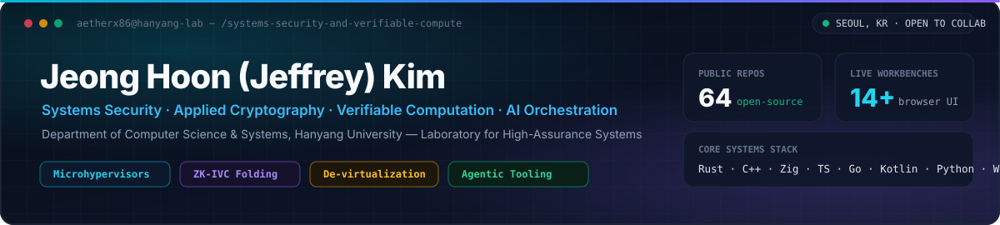
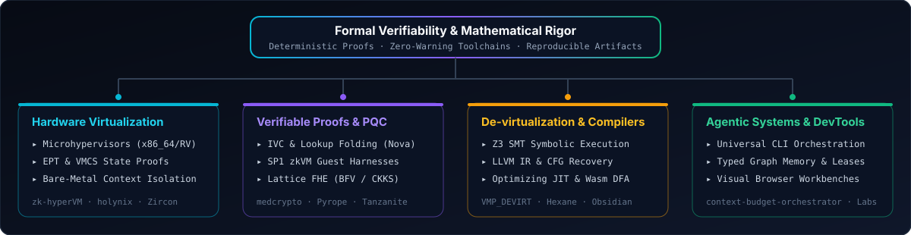
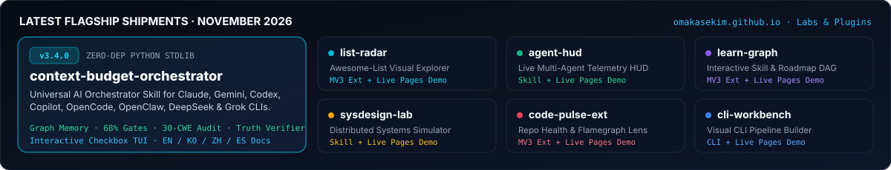

<p align="center">
  <a href="https://omakasekim.github.io">
    
  </a>
</p>

<p align="center">
  <a href="https://omakasekim.github.io"></a>
  <a href="https://github.com/omakasekim"></a>
  <a href="https://gitlab.com/jk9576"></a>
  <a href="mailto:jk9576@hanyang.ac.kr"></a>
</p>

<p align="center">
  
  
  
  
  
  
  
  
  
</p>

---

> **Support Independent Research**  
> I am an independent researcher engineering open-source systems security tools, applied cryptographic primitives, microhypervisors, verifiable computing primitives, and agentic developer infrastructure. All research across these repositories is self-directed and personally funded. Any monetary support, institutional research grants, or individual sponsorship to help fund server compute, test hardware, publication costs, and ongoing development is deeply appreciated.  
> 
> [](https://github.com/sponsors/omakasekim)
> [](https://buymeacoffee.com/Aetherx86)
> [](https://ko-fi.com/Aetherx86)
> [](https://paypal.me/Aetherx86)

---

<p align="center">
  
</p>

---

## Research Paradigm & Theoretical Formulation

My research operates at the nexus of **hardware-assisted systems virtualization**, **verifiable computation (Zero-Knowledge Proofs & Incrementally Verifiable Computation)**, and **automated binary analysis/compiler security**. The overarching objective is to establish provable execution guarantees for untrusted virtualized environments while engineering deterministic mathematical frameworks for de-obfuscating protected native software.

```math
\mathcal{V}_{\text{sys}} = \left\lbrace (s, \tau, s') \in \mathcal{S} \times \mathcal{T} \times \mathcal{S} \;\middle|\; \Pi_{\text{EPT}}(s, \tau) \models s' \land \Delta_{\text{IVC}}(\vec{u}_i, \vec{w}_i) = \text{ACCEPT} \right\rbrace
```

### Primary Investigation Pillars

- **Hardware-Assisted Virtualization & Microhypervisors**: Formal verification of Extended Page Table (EPT) state transitions, Virtual Machine Control Structure (VMCS) invariant enforcement, and zero-trust nested virtualization primitives on bare-metal x86_64 and RISC-V architectures.
- **Incrementally Verifiable Computation (IVC) & Folding Schemes**: Lookup-accelerated folding architectures (Nova, SuperNova, and HyperNova paradigms) applied to hypervisor transitions, zkVM verification harnesses, and trustless state transitions.
- **Binary De-virtualization & Program Synthesis**: Abstract interpretation, SMT-driven symbolic execution (Z3), control flow graph (CFG) normalization, and intermediate representation (LLVM IR) lifting targeting multi-layered commercial virtualization-based obfuscators.
- **Post-Quantum Cryptography & High-Assurance Runtimes**: Lattice-based Fully Homomorphic Encryption (BFV/CKKS) for privacy-preserving computation, zero-retention compliance engines, and deterministic monorepo verification pipelines.

---

## Technical Foundations & Verified Systems Footprint

Quantitative breakdown of active open-source systems, experimental compilers, and research codebases:

| Metric | Empirical Measurement | Architectural Significance |
| :--- | :--- | :--- |
| **Active Systems & Repositories** | 63 Public Open-Source Systems | 14+ Live Browser Workbenches &bull; Systems, Crypto, Compilers & Agentic AI |
| **Verified Net Footprint** | ~110.2 MB Executable Source | Zero vendor bloat; net algorithm implementations and test vectors |
| **Target Architectures** | x86_64, RISC-V, ARM64 | Bare-metal hypervisors, native instruction engines, WASI runtimes |
| **Verification Rigor** | 100% Deterministic CI/CD | Zero-warning policy (`-D warnings`), automated Gitleaks, memory safety |

### Architectural Distribution by System Layer

| Language / Domain | Flagship Repositories | Research Scope & Role | Footprint Share |
| :--- | :--- | :--- | :--- |
| **TypeScript / Node.js** | `sentinel-kit`, `rea`, `fakecut` | High-assurance policy verification, AST manipulation, decompilation | 48.8 MB (44.2%) |
| **JavaScript / Web Standards** | `aether`, `Elsevier-Educhain` | Web-based instrumentation, interactive research artifacts, runtimes | 35.2 MB (31.9%) |
| **C / Modern C++** | `VMP_DEVIRT`, `TIL`, `aether` | SMT symbolic engines, disassemblers, native hypervisor microkernels | 5.1 MB (4.6%) |
| **Rust** | `zk-hyperVM`, `Zeolite`, `medcrypto`, `rusty-chain-kit` | Verifiable folding circuits, SP1 guest harnesses, lattice FHE cryptosystems | 4.6 MB (4.2%) |
| **Kotlin / JVM** | `Ferrite`, `Silica`, `Pyrite`, `Boron`, `Rhizome` | Cellular automata, JVM bytecode JIT compilers, compile-time code generation, BitTorrent and Kademlia DHT | 1.2 MB (1.1%) |
| **Python** | `PHYSICS`, `MATH`, `diffing_obfu` | SMT solvers, mathematical physics modeling, formal proof verifiers | 2.0 MB (1.8%) |
| **Assembly (x86_64 / RISC-V)** | `holynix`, `zk-hyperVM` | Bare-metal bootstrap, context switching, EPT / VMCS fault handlers | Core System Layer |
| **Perl & Shell** | `Tangerine`, CI/CD Suites | Systems build orchestration, compiler tooling, automated release verification | 12.1 MB (11.0%) |

---

## Selected Systems & Research Artifacts

### 1. zk-HyperKVM ([zk-hyperVM](https://github.com/omakasekim/zk-hyperVM) &bull; [Workbench](https://omakasekim.github.io/workbench/))
*Verifiable Hardware-Assisted Virtualization via Lookup-Accelerated Incremental Folding over Extended Page Tables and VMCS Transitions*
- Introduces an Incrementally Verifiable Computation (IVC) architecture for proving correct hardware virtualization state transitions without trusting the host hypervisor.
- Encodes 4-level x86_64 EPT paging structures and VM-exit/VM-entry VMCS register states into committed polynomial relations.
- Combines log-derivative multiset lookup arguments with SP1 RISC-V zero-knowledge verifiable execution harnesses.
- Evaluated across 43 automated formal test suites with multi-OS verification pipelines.

### 2. VMP_DEVIRT ([VMP_DEVIRT](https://github.com/omakasekim/VMP_DEVIRT))

Also home to `wasm-superopt`, a WebAssembly deobfuscator built on simplifications that are proofs, and `absint`, an abstract interpretation analyzer for memory safety and data races.

*Automated Symbolic De-virtualization & Intermediate Representation Lifting Engine*
- Research framework targeting layered virtualization-based commercial obfuscators (VMProtect).
- Employs dynamic trace recording, taint analysis, dead-code elimination, and symbolic simplification via Z3 SMT solver.
- Recovers normalized Control Flow Graphs (CFGs) and re-synthesizes optimized LLVM IR from obfuscated bytecode interpreter loops.

### 3. medcrypto ([medcrypto](https://github.com/omakasekim/medcrypto))

Its core cryptography is also one WebAssembly Component with no imports, running unchanged from Python, TypeScript and Go.

*Lattice-Based Post-Quantum Medical Data Cryptography & FHE Suite*
- Implements ring learning with errors (RLWE) Fully Homomorphic Encryption schemes (BFV and CKKS) for blind diagnostic evaluation.
- Features multi-party secret sharing, verifiable zero-knowledge clinical inference, and post-quantum digital signatures.
- Verified with strict documentation assertions, zero-warning rustdoc builds, and automated security audits.

### 4. sentinel-kit ([sentinel-kit](https://github.com/omakasekim/sentinel-kit))
*Deterministic, Zero-Retention Enterprise Policy & Compliance Auditing Suite*
- Monorepo matrix impact analysis engine utilizing Wilson score dampening to prune unimpacted CI test cells.
- Pre-flight DDL lock-hazard AST detector for PostgreSQL migrations (Prisma, Flyway, Alembic) and schema drift verifier.
- Zero-retention PII scanner supporting direct PDF content stream rewriting and dual pure-JS/WASI-Go WebAssembly kernels.
- Complete deterministic test coverage across 90 unit and dist-equivalence verification suites.

### 5. Rusty Chain Kit ([rusty-chain-kit](https://github.com/omakasekim/rusty-chain-kit) • [Wiki & User Guide](https://github.com/omakasekim/rusty-chain-kit/wiki))
*All-in-One Ethereum Toolchain, Visual Forensics & Smart Contract Security Hub*
- Unifies smart contract compilation, formal SMT verification, stateful dynamic fuzzing, storage collision diffing, and live REPL scratchpad into a single native binary (`para`).
- Features a Chainalysis Reactor-grade on-chain visual forensics kit with multi-hop fund flow tracing, OFAC SDN sanctions screening, direct mixer taint calculation, and automated compliance dossier generation.
- Features complete user-centric onboarding documentation, quickstart workflows, and safety FAQs in the [Dedicated Wiki](https://github.com/omakasekim/rusty-chain-kit/wiki).

### 6. Hexane ([Hexane](https://github.com/omakasekim/Hexane))
*Ultra-Fast, Memory-Safe Carbon Language Compiler, SemIR Engine & REPL*
- High-performance, zero-dependency Carbonation toolchain written in 100% safe Rust with zero segfaults or memory leaks.
- Features complete end-to-end SemIR (Semantic IR) pipeline, direct C99/C++ translation, native `-O3` assembly code generation, and interactive REPL.
- Built-in bytecode re-virtualizer and Control Flow Flattening (CFF) runner for code protection.

### 7. aether & holynix ([aether](https://github.com/omakasekim/aether) / [holynix](https://github.com/omakasekim/holynix))
*Bare-Metal Sovereign Microkernel & Hypervisor Research Systems*
- `aether`: Minimalist x86_64 hardware hypervisor enforcing capability-based memory isolation and strict hypercall interfaces.
- `holynix`: 64-bit ring-0 operating system kernel written in HolyC with pure C fallback support, custom memory allocators, and multitasking scheduler.

### 8. Elsevier Research Artifacts ([Elsevier-TACC](https://github.com/omakasekim/Elsevier-TACC) / [Elsevier-Educhain](https://github.com/omakasekim/Elsevier-Educhain))
*Peer-Reviewed Research Implementations & Reproducibility Packages*
- Official artifacts accompanying peer-reviewed journal/conference submissions.
- Contains end-to-end evaluation scripts, raw benchmark telemetry, and automated verification suites.

### 9. Zeolite ([Zeolite](https://github.com/omakasekim/Zeolite))

A replicated micro-VM cluster built from scratch: Raft consensus with pre-vote and check-quorum, a KVM and Hypervisor.framework micro-VM manager that boots a real Linux kernel, and a Cranelift JIT with gas metering, differentially tested against a reference interpreter.

### 10. Silica ([Silica](https://github.com/omakasekim/Silica) &bull; [Run it live](https://omakasekim.github.io/silica/))

Conway's Game of Life with bit-sliced and Hashlife engines, and a falling sand world with regions that sleep when nothing in them moves.

### 11. Pyrite ([Pyrite](https://github.com/omakasekim/Pyrite))

A zero-boxing bytecode VM and a Brainfuck compiler that emit JVM bytecode into hidden classes, so the JVM's own JIT turns them into native code.

### 12. Boron ([Boron](https://github.com/omakasekim/Boron))

A KSP2 processor that generates zero-reflection, zero-allocation bitmask diffs and struct mappers at compile time, with incremental builds.

### 13. Rhizome ([Rhizome](https://github.com/omakasekim/Rhizome))

A BitTorrent client and Kademlia DHT node in Kotlin coroutines, with magnet links, request pipelining and iterative lookups.

### 14. Ferrite ([Ferrite](https://github.com/omakasekim/Ferrite) &bull; [Try it](https://omakasekim.github.io/ferrite/))

A transit app for all of Korea in Kotlin Multiplatform, for Android, iOS and the web: platform boards with sound and moving trains, network maps generated from open data, offline trip planning, walking and driving directions on a vector map it draws itself, and routes abroad.

### 15. REA ([rea](https://github.com/omakasekim/rea) &bull; [Workbench](https://omakasekim.github.io/rea/))

Multi-engine reverse-engineering platform (`v7.1.0`, now with RISC-V decoding and offline evidence-ledger verification) combining a 16-crate native Rust workspace (Mach-O, ELF, PE, DEX, WebAssembly, and archive parsers; x86/x86_64/ARM/AArch64/sBPF decoders; CFG and dataflow recovery; clean-room Pseudo-C decompiler; hash-chained evidence ledger; egui desktop workbench) with a 302-tool Model Context Protocol (MCP) server.

### 16. Assay ([Assay](https://github.com/omakasekim/Assay) &bull; [Try it](https://omakasekim.github.io/assay/))

Cross-checks what Korean listed companies report in their financial statements against independent audit reports, OpenDART XBRL, US SEC 20-F filings, credit ratings, and public registries across 10 verification layers, evaluated under a pre-registered 39-company-year validation protocol.


### 17. November 2026 releases

Every project below shipped a new minor release on 2026-11-20/21 with new capabilities, hostile-input hardening and real tests, and passes CI.

| Project | Version | What it is |
| :--- | :--- | :--- |
| [Alexandrite](https://github.com/omakasekim/Alexandrite) ([live](https://omakasekim.github.io/alexandrite/)) | 0.2.0 | Minimal-DFA regex compiler and lexer in Zig and WebAssembly, with language-equivalence checking |
| [Celestine](https://github.com/omakasekim/Celestine) ([live](https://omakasekim.github.io/celestine/)) | 0.2.0 | Polyphonic synthesizer and FFT analyzer in Zig and WebAssembly |
| [Spinel](https://github.com/omakasekim/Spinel) ([live](https://omakasekim.github.io/spinel/)) | 0.2.0 | ELF, PE and Mach-O section parser, entropy maps, packer detection and binary diff |
| [Zircon](https://github.com/omakasekim/Zircon) ([live](https://omakasekim.github.io/zircon/)) | 0.2.0 | Reversible RV32IM emulator with a pipeline hazard model, assembler and disassembler |
| [Halite](https://github.com/omakasekim/Halite) ([live](https://omakasekim.github.io/halite/)) | 0.2.0 | Deterministic fixed-point Lattice Boltzmann fluid solver |
| [Corundum](https://github.com/omakasekim/Corundum) | 0.2.0 | eBPF assembler, reference VM and path-sensitive verifier |
| [Tanzanite](https://github.com/omakasekim/Tanzanite) | 0.2.0 | CDCL SAT solver with DRUP proofs and its own proof checker |
| [Pyrope](https://github.com/omakasekim/Pyrope) | 0.2.0 | Constant-time WireGuard (Noise_IKpsk2) engine |
| [Obsidian](https://github.com/omakasekim/Obsidian) | 0.2.0 | Optimizing x86_64/AArch64 JIT with a register allocator and differential fuzzer |
| [Beryl](https://github.com/omakasekim/Beryl), [Chrysoberyl](https://github.com/omakasekim/Chrysoberyl), [Kyanite](https://github.com/omakasekim/Kyanite), [Stibnite](https://github.com/omakasekim/Stibnite), [Realgar](https://github.com/omakasekim/Realgar), [Zoisite](https://github.com/omakasekim/Zoisite) | 0.2.0 | CoW B-tree storage, columnar SIMD queries, snapshot fuzzing, syscall policy, x86_64 kernel, cycle-counter benchmarking |
| [Pyx](https://github.com/omakasekim/Pyx), [Gabbro](https://github.com/omakasekim/Gabbro), [Clino](https://github.com/omakasekim/Clino), [Sard](https://github.com/omakasekim/Sard), [Scapolite](https://github.com/omakasekim/Scapolite) | 0.2.0 | Go: PostgreSQL proxy gatekeeper, Raft simulator, unsafe/CGo analyzer (SARIF), JA4 fingerprinting, EVM mempool scheduler |
| [Pyrite](https://github.com/omakasekim/Pyrite), [Boron](https://github.com/omakasekim/Boron), [Rhizome](https://github.com/omakasekim/Rhizome), [Silica](https://github.com/omakasekim/Silica), [Argon](https://github.com/omakasekim/Argon) | 0.2.x | Kotlin: VM with JIT to JVM bytecode, KSP bit packing, BitTorrent/DHT, Life-like rules and Hashlife, ARM7/ARM9 emulator |
| [Ferrite](https://github.com/omakasekim/Ferrite) | 0.3.0 | Transit trips that trade time for transfers, hour-aware transfer waits |
| [zk-hyperVM](https://github.com/omakasekim/zk-hyperVM), [Zeolite](https://github.com/omakasekim/Zeolite), [medcrypto](https://github.com/omakasekim/medcrypto), [VMP_DEVIRT](https://github.com/omakasekim/VMP_DEVIRT), [ctxflow](https://github.com/omakasekim/ctxflow), [aether-license](https://github.com/omakasekim/aether-license) | 0.4.0, 0.2.0, 0.5.0, 1.3.0, 0.4.1, 0.2.0 | Rust: IVC folding checks, Raft leadership transfer, FHE analytics, MBA/opaque-predicate proofs, context kernel, Ed25519 licensing |
| [Assay](https://github.com/omakasekim/Assay), [sentinel-kit](https://github.com/omakasekim/sentinel-kit), [ceasefire](https://github.com/omakasekim/ceasefire), [fakecut](https://github.com/omakasekim/fakecut), [Educhain](https://github.com/omakasekim/Educhainkit) | 0.2.0, 1.2.0, 0.2.0, 0.2.0, 1.1.0 | Filing cross-checks with Benford screening, compliance tooling, capability sandboxing, timeline editor with FCPXML/EDL export, on-chain peer review |

### 18. AI Orchestration & Visual Developer Plugins (2026-11-25)

<p align="center">
  <a href="https://omakasekim.github.io">
    
  </a>
</p>

| Project | Version / Type | Live Demo | Highlights |
| :--- | :--- | :--- | :--- |
| **[context-budget-orchestrator](https://github.com/omakasekim/context-budget-orchestrator)** | `v3.4.0` · Universal AI Skill | CLI / 8+ Harnesses | Zero-dep Python stdlib orchestrator for Claude, Gemini, Codex, Copilot, OpenCode, OpenClaw, DeepSeek & Grok: typed graph memory, 68% budget gates, AST parallel waves, 30-CWE/OpenAPI security audit, ground-truth git verifier, interactive checkbox selector, EN/KO/ZH/ES docs |
| **[list-radar](https://github.com/omakasekim/list-radar)** | MV3 Extension + Web | [Launch Live](https://omakasekim.github.io/list-radar/) | Interactive awesome-list & GitHub ecosystem visual explorer with graph/table lenses |
| **[agent-hud](https://github.com/omakasekim/agent-hud)** | Agent Skill + Web | [Launch Live](https://omakasekim.github.io/agent-hud/) | Real-time multi-agent telemetry, token-burn flamegraphs, and session HUD |
| **[learn-graph](https://github.com/omakasekim/learn-graph)** | MV3 Extension + Web | [Launch Live](https://omakasekim.github.io/learn-graph/) | Interactive prerequisite DAG & engineering roadmap graph visualizer |
| **[sysdesign-lab](https://github.com/omakasekim/sysdesign-lab)** | Agent Skill + Web | [Launch Live](https://omakasekim.github.io/sysdesign-lab/) | Visual distributed-systems architecture & latency/throughput simulator |
| **[code-pulse-ext](https://github.com/omakasekim/code-pulse-ext)** | MV3 Extension + Web | [Launch Live](https://omakasekim.github.io/code-pulse-ext/) | Repository health, churn hotspots, and complexity flamegraph overlay |
| **[cli-workbench](https://github.com/omakasekim/cli-workbench)** | CLI Companion + Web | [Launch Live](https://omakasekim.github.io/cli-workbench/) | Visual CLI pipeline composer, flag inspector, and live shell simulator |

---

## Scholarly Publications & Research Preprints

1. **zk-HyperKVM: Verifiable Hardware-Assisted Virtualization via Lookup-Accelerated Incremental Folding over Extended Page Tables and VMCS Transitions**  
   *Jeong Hoon Kim*  
   *Cryptology ePrint Archive / Research Monograph, 2026.*  

2. **TACC: Trustworthy Access Control and Collaborative Framework for Decentralized Compute**  
   *Jeffrey Kim, et al.*  
   *Elsevier Publications / Research Proceedings, 2026.*  

3. **Educhain: Verifiable Academic Credential Ledger with Zero-Knowledge Selective Disclosure**  
   *Jeffrey Kim, et al.*  
   *Elsevier Publications / Research Proceedings, 2026.*  

4. **Monograph I: A Treatise on Epistemic Justification Beyond Cognitive Surveyability in Automated Proof Verification**  
   *Jeong Hoon Kim*  
   *Theoretical Computer Science & Mathematical Foundations Monograph, 2026.*  

---

## Engineering Standards & Quality Assurance

All maintained repositories conform to strict safety and continuous verification standards:
- **Zero-Warning Compilation Policy**: Built with `RUSTFLAGS="-D warnings"` (Rust) and strict compiler flags (`-Wall -Wextra -Werror` in C/C++).
- **Multi-Platform Verification Matrix**: Automated CI validation runs across `ubuntu-latest` and `macos-latest` runners on every commit.
- **Automated Security Auditing**: Scheduled dependency vulnerability scans (`cargo audit`, `npm audit`) and automated secret leak prevention (`gitleaks`).
- **Cryptographic Reproducibility**: Pinned toolchains, deterministic builds, and standalone verification vectors.

---

## Supporting Independent Research & Funding Channels

As an individual student researcher working without external venture capital or dedicated corporate grants, all research prototypes, formal verification harnesses, and high-assurance compiler toolchains are built independently.

Financial contributions directly sustain:
- Cloud compute infrastructure and CI runner minutes for extensive test matrix suites.
- Dedicated hardware testbeds for bare-metal x86_64 and RISC-V virtualization research.
- Independent academic publication costs and monograph dissemination.

### 1-Click Sponsorship & Direct Support

| Platform | Direct Link | Settlement Methods |
| :--- | :--- | :--- |
| **GitHub Sponsors** | [sponsor/omakasekim](https://github.com/sponsors/omakasekim) | Recurring / One-time (0% platform fee for individuals) |
| **Buy Me a Coffee** | [buymeacoffee.com/Aetherx86](https://buymeacoffee.com/Aetherx86) | Credit / Debit Card, Apple Pay, Google Pay |
| **Ko-fi** | [ko-fi.com/Aetherx86](https://ko-fi.com/Aetherx86) | Credit Card, PayPal (0% platform fee) |
| **PayPal** | [paypal.me/Aetherx86](https://paypal.me/Aetherx86) | Direct PayPal Transfer |

### Web3 / Direct Crypto Settlement

For protocol contributors and researchers who prefer direct on-chain settlement:

| Asset / Network | Deposit Reference | Supported Assets |
| :--- | :--- | :--- |
| **Ethereum** | *Available upon inquiry* | ETH, USDC, USDT, DAI |
| **Solana** | *Available upon inquiry* | SOL, USDC |
| **Bitcoin** | *Available upon inquiry* | BTC (Native SegWit) |

> For dedicated on-chain payment hashes or invoice receipts, please email [jk9576@hanyang.ac.kr](mailto:jk9576@hanyang.ac.kr).

---

## Services & Commercial Consulting

In addition to academic research, I accept high-leverage technical consulting engagements, protocol security audits, and private advisory for engineering teams:

| Service Domain | Deliverable Scope | Tooling & Methodology |
| :--- | :--- | :--- |
| **Smart Contract Audits & Forensics** | Dynamic stateful fuzzing, invariant testing, reentrancy analysis, and multi-hop fund flow tracing | `rusty-chain-kit`, SMT symbolic solvers |
| **Binary De-virtualization & Reverse Engineering** | Control-flow graph recovery, SMT-driven semantic flattening, and LLVM IR lifting | `VMP_DEVIRT`, automated symbolic engines |
| **Verifiable zkVM & IVC Audits** | Constraint verification, lookup argument analysis, and folding circuit soundness checks | `zk-hyperVM`, Nova / SuperNova harnesses |
| **Post-Quantum Cryptography** | Lattice-based RLWE (BFV/CKKS) scheme evaluation and secure enclave design | `medcrypto`, verified Rust cryptosystems |
| **Database & CI/CD Optimization** | Destructive DDL lock-hazard preflight and matrix pruner deployment | `sentinel-kit` ($3.90–$9.90/mo or $49.90 audit) |

### Engagement Inquiries
To request a private scoping call, advisory retainer, or fixed-rate quote for an audit:
- **Email**: [jk9576@hanyang.ac.kr](mailto:jk9576@hanyang.ac.kr) (include project scope, timeline, and code repository links).
- **Turnaround**: Initial scope review and feasibility response within 24 hours.

---

## Academic & Technical Inquiries

- **Institutional Affiliation**: Department of Computer Science & Systems, Hanyang University, Seoul, South Korea
- **Institutional Email**: `jk9576@hanyang.ac.kr`
- **GitLab Research Mirror**: [gitlab.com/jk9576](https://gitlab.com/jk9576)
- **GitHub Repository**: [github.com/omakasekim](https://github.com/omakasekim)
- **Cryptographic Authentication**: Public key fingerprints and signed commits available upon authenticated request.
